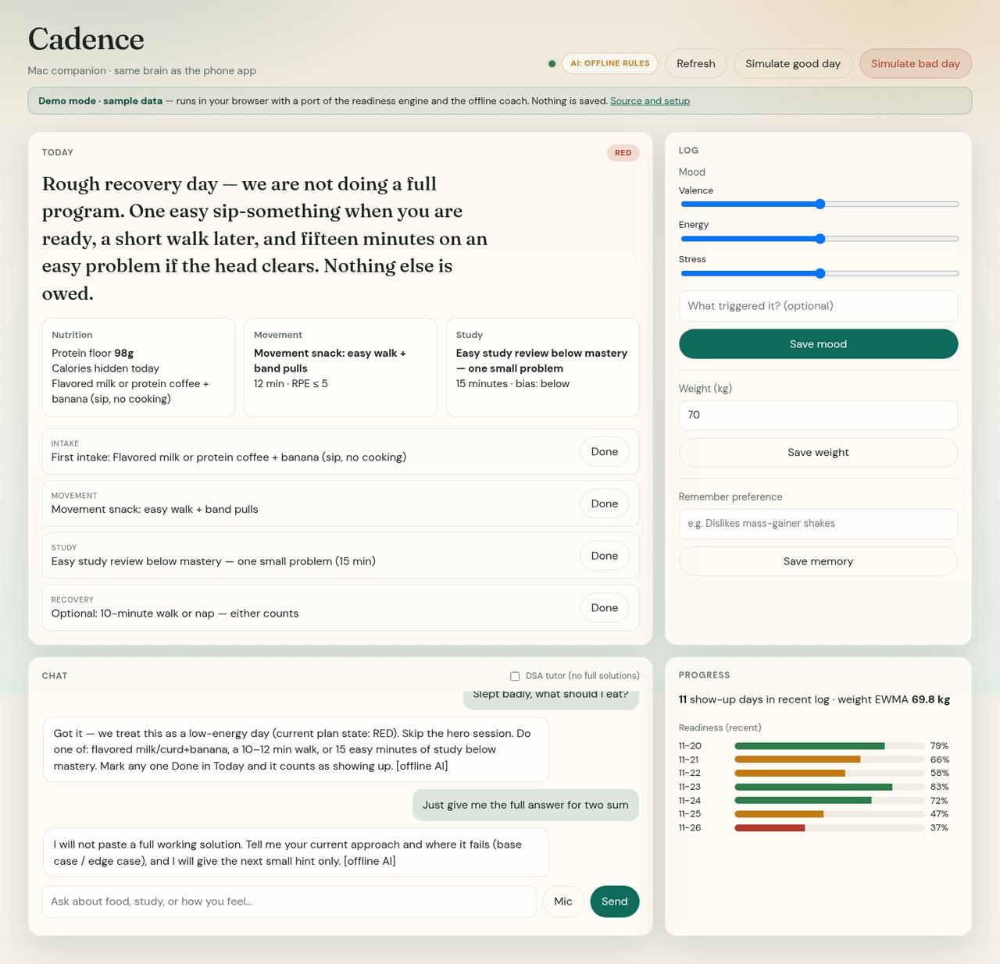
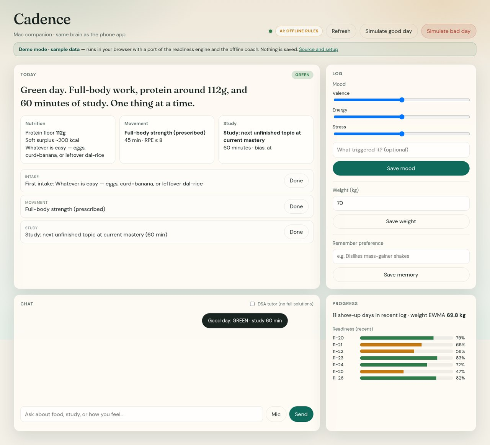
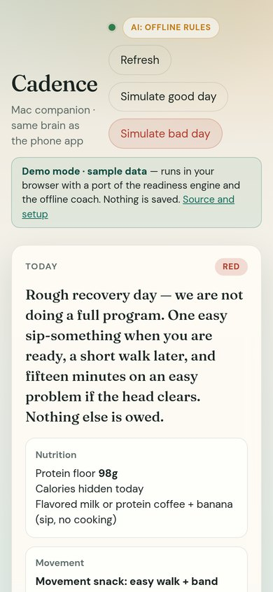

# Cadence

**An adaptive, voice-first, burnout-aware performance companion.** Cadence reads last night's recovery and today's mood, decides what kind of day it is, and reshapes the plan for training, nutrition and study around it. On a rough morning it says one kind sentence, asks for one small thing, and counts fifteen honest minutes as a win.

**[▶ Live demo](https://akhilsingh2.github.io/cadence/)**: the web UI in demo mode, running in your browser with sample data.



## What it does

- **Readiness engine.** It scores the day from sleep duration and efficiency, HRV and resting heart rate (against your own 14-day baselines) and a quick mood check-in, then classifies it as **GREEN**, **AMBER**, **RED** or **DELOAD**. High stress or low mood caps the score.
- **Adapted daily plan.** Each day state changes the workout (full session, scaled session or a 12-minute movement snack), the nutrition framing (a protein floor, with calories hidden on hard days) and the study block (60, 30 or 15 minutes, at or below current mastery). Each plan is split into micro-tasks, and finishing any one counts as showing up.
- **Tone as an invariant.** Every day state carries a tone (`coaching`, `neutral`, `empathetic_no_guilt`), and the chat prompt enforces it. Missed days are never guilt-tripped.
- **Chat with long-term memory.** Preferences, triggers and recurring mistakes are stored as embeddings and recalled in context, so it remembers that you can't stand mass-gainer shakes.
- **DSA tutor guardrail.** In tutor mode it gives Socratic hints only. A detector catches replies that look like a full solution, regenerates them once, and falls back to a refusal if needed. After three tagged attempts, a recurring bug type is promoted to a `bug_pattern` memory.
- **Voice.** The iOS app streams speech-to-text over a WebSocket and speaks replies sentence by sentence. The web UI uses the browser's speech recognition and synthesis.
- **Works without an API key.** If `GEMINI_API_KEY` isn't set, a deterministic offline coach answers from the day's plan, and embeddings fall back to a local pseudo-embedding, so the whole loop runs offline.

| Green day | Mobile |
| --- | --- |
|  |  |

## Architecture

```
 iOS app (SwiftUI)          Web UI (served at /)
 HealthKit · Charts         plan · log · chat · mic
 voice STT/TTS                     │
        │  REST /v1 + WebSocket    │
        └──────────────┬───────────┘
              ┌────────▼─────────────────────────────┐
              │ FastAPI (backend/app)                 │
              │  gateway/  REST + voice WebSocket     │
              │  engine/   readiness + plan adapter   │
              │  memory/   ingest · retrieve · consolidate
              │  llm/      Gemini router + offline fallback
              │  tools/    DSA tutor guardrail        │
              └────────┬─────────────────────────────┘
                       │ asyncpg
              ┌────────▼─────────────────────────────┐
              │ Postgres 16 + pgvector               │
              │  health, mood, body metrics, plans,  │
              │  micro-tasks, conversations, study,  │
              │  memory_chunks (vector + tsvector)   │
              └──────────────────────────────────────┘
```

| Layer | Location | Notes |
| --- | --- | --- |
| API | [`backend/app/`](backend/app/) | FastAPI with an asyncpg pool. Pydantic settings, and a dev auth header for single-user local runs. |
| Web UI | [`backend/web/`](backend/web/) | Plain HTML, CSS and JavaScript, served by the API at `/`. |
| Schema | [`supabase/migrations/`](supabase/migrations/) | `0001_local.sql` for Docker and `0001_init.sql` for Supabase (with RLS policies). |
| iOS | [`ios/`](ios/) | SwiftUI (iOS 17+) with HealthKit sync, voice check-ins, a Today view and a Charts dashboard. The project is generated with XcodeGen. |
| Design docs | [`docs/`](docs/) | Architecture, data model, behavioural engine, stack and cost, roadmap. |

## Backend and engineering notes

**API surface (`/v1`).** `POST /health/sync`, `/mood`, `/weight`, `/preferences`, `/problems/attempt`, `/tasks/complete` and `/chat`. `GET /plans/today`, `/dashboard`, `/status` and `/healthz`. `POST /jobs/morning` and `/jobs/consolidate`, protected by a shared `JOB_SECRET` for a scheduler. `POST /demo/bad-day` and `/demo/good-day` seed realistic HealthKit-like rows for demos. Every logging endpoint rebuilds and saves the day's plan, so the UI always reflects the latest signal. Interactive docs are at `/docs`.

**Readiness and planning.** `engine/readiness.py` weights sleep at 30%, sleep efficiency at 15%, HRV z-score against baseline at 25%, inverse resting-HR z-score at 15% and energy at 15%. It clamps the score when stress is 4 or more or mood is 2 or less, and forces DELOAD after three red days in a row. `engine/adapter.py` turns the state into concrete prescriptions, micro-tasks and an opener line. `services/planning.py` persists the plan, its tasks and the readiness history.

**Memory with pgvector.** Memories are stored in `memory_chunks` with a 768-dimension `vector` (HNSW, cosine) and a generated `tsvector`. Retrieval runs vector search and full-text search in parallel, merges them with reciprocal rank fusion, and weights the result by salience and a 45-day recency decay. A consolidation job folds day-old episodic notes into durable semantic and preference memories.

**LLM routing and fallback.** `llm/router.py` sends chat to a fast Gemini tier and tutoring to a stronger tier. With no key, or on any model error, it returns the offline coach's reply, built from the day state, protein floor and study minutes. The response reports `model_tier: "none"` so the UI can label it. Embeddings fall back the same way.

**Data model.** About 20 tables: profile and goals, daily health, mood check-ins, body metrics with an EWMA weight trend, meals, workouts and sets, the study catalogue and progress, problem attempts, daily plans, micro-tasks and streaks, conversations and messages, and memory and curriculum chunks. The Supabase migration adds row-level security so every row is scoped to `auth.uid()`.

**Current limits.** Auth is single-user: the API trusts an `X-User-Id` header when `ALLOW_DEV_AUTH` is on, and Supabase JWT validation is the next step on the roadmap. Background jobs are endpoints and aren't scheduled yet.

## Run locally

Requirements: Docker. Python 3.12+ is optional, for running the API outside Docker.

```bash
cp .env.example .env              # GEMINI_API_KEY is optional
docker compose up -d --build      # Postgres + pgvector on :5434, API on :8000
open http://127.0.0.1:8000/       # web UI
```

- API docs: http://127.0.0.1:8000/docs
- Health check: http://127.0.0.1:8000/v1/healthz
- Try a red day: press **Simulate bad day** in the web UI, or run `curl -X POST http://127.0.0.1:8000/v1/demo/bad-day`

To run the API without Docker:

```bash
docker compose up -d db
cd backend
python3 -m venv .venv && source .venv/bin/activate
pip install -r requirements.txt
cp ../.env.example .env
uvicorn app.main:app --reload --port 8000
```

Or run `./scripts/dev_up.sh` to do all of that in one step.

### iOS

```bash
brew install xcodegen
cd ios && xcodegen generate && open Cadence.xcodeproj
```

Set your signing team. The simulator talks to `http://127.0.0.1:8000/v1`. On a device, set your computer's LAN IP under **Log → API**.

## Tests

```bash
cd backend && python -m pytest                            # readiness engine + DSA guardrail unit tests
./scripts/smoke_test.sh http://127.0.0.1:8000/v1      # end-to-end against a running stack
```

The smoke test runs a bad day and checks for a RED or AMBER state, hidden calories and a short study block. It then exercises chat, saves a preference, logs three tagged problem attempts (checking for `bug_pattern` promotion) and reads the dashboard. CI runs both against a pgvector Postgres service on every push.

## Demo mode

The [live demo](https://akhilsingh2.github.io/cadence/) is a static build of the same web UI, made with `python3 scripts/build_demo.py`. It adds [`demo/demo-api.js`](demo/demo-api.js), which answers the UI's `/v1` calls in the browser:
- readiness scoring is a line-by-line port of `readiness.py`
- the plans for each day state are snapshots of real API responses
- chat uses a port of the offline coach
- all history is made-up sample data

The demo shows a **Demo mode · sample data** banner. The API never serves the demo script, so a normal `docker compose up` is unaffected.

## Licence

MIT. See [LICENSE](LICENSE).
