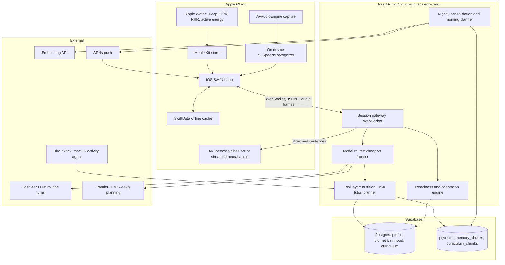
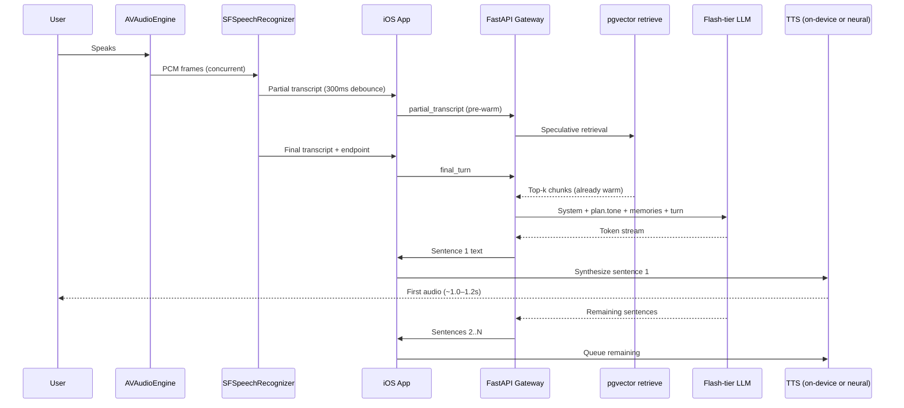
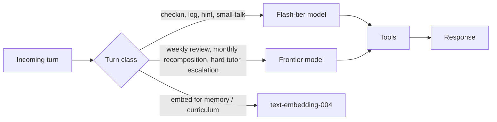

# System Architecture & Data Flow

Adaptive, voice-first personal performance companion for lean-bulk recomposition, study-programme consistency, and burnout-aware daily planning.

**Constraints locked in:** single-user first (multi-tenant-ready via `user_id` + RLS), native SwiftUI + watchOS, hard budget under $25/month.

---

## 1. High-level component diagram



---

## 2. Client layer (iOS + watchOS)

### Responsibilities

| Surface | Role |
|---|---|
| iPhone (SwiftUI, iOS 17+) | Primary UI, voice sessions, HealthKit sync authority, local notifications, dashboard |
| Apple Watch | Sensor source + quick logging (mood tap, workout start). Never authoritative for writes |
| SwiftData | Offline cache of today's plan, last 7 days of biometrics, pending sync queue |

### HealthKit sync design

1. Request read access for: sleep analysis (stages), resting heart rate, heart rate variability (SDNN), active energy burned, steps, body mass, workouts.
2. Register `HKObserverQuery` for each type and call `enableBackgroundDelivery(.immediate)` (or `.hourly` for steps/energy).
3. On observer fire, run an `HKAnchoredObjectQuery` using the stored anchor so only deltas are fetched.
4. Batch deltas into a `HealthSyncPayload` and POST `/v1/health/sync`. Persist the new anchor and last-success timestamp in Keychain.
5. On cold launch or after >6h without a background delivery, run a catch-up anchored query for the last 48h.

The watch app reads mirrored HealthKit data and can enqueue a mood/workout event to the phone via WatchConnectivity; the phone is the only writer to the backend.

### Offline behavior

- Today's `daily_plan` and micro-tasks are cached in SwiftData at last successful fetch.
- Voice sessions require network; if offline, the app falls back to tap-logging (mood, meal, workout) queued for sync.
- Local notifications for wake-relative check-ins are scheduled on-device so they fire even when Cloud Run is cold.

---

## 3. Backend orchestration (FastAPI on Cloud Run)

### Process layout

```
backend/
  app/
    main.py              # FastAPI app, lifespan, CORS
    gateway/
      websocket.py       # Voice session WebSocket
      rest.py            # /health/sync, /plans, /chat, /dashboard
    engine/
      readiness.py       # Score + DayState classification
      adapter.py         # adapt_plan() for GREEN/AMBER/RED/DELOAD
      planner.py         # Baseline plan + micro-task generation
    memory/
      retrieve.py        # Hybrid search + RRF + MMR
      ingest.py          # Embed + write memory_chunks
      consolidate.py     # Nightly episodic → semantic promotion
    tools/
      nutrition.py
      dsa_tutor.py
      curriculum.py
      integrations.py    # Jira / Slack / activity agent
    llm/
      router.py          # Flash vs frontier selection
      prompts.py
    jobs/
      morning_plan.py
      nightly_consolidate.py
```

### Request paths

| Path | Protocol | Purpose |
|---|---|---|
| `WS /v1/voice` | WebSocket | Bidirectional: partial transcripts in, streamed sentences + audio out |
| `POST /v1/health/sync` | REST | Anchored HealthKit delta upload |
| `POST /v1/chat` | REST | Text-only fallback chat (Phase 1) |
| `GET /v1/plans/today` | REST | Current adapted daily plan |
| `POST /v1/mood` | REST | Mood check-in from phone or Watch |
| `GET /v1/dashboard` | REST | Aggregates for Charts |
| `POST /v1/jobs/morning` | Internal | Triggered by `pg_cron` / Cloud Scheduler |
| `POST /v1/jobs/consolidate` | Internal | Nightly memory consolidation |

Cloud Run is configured for scale-to-zero, min instances = 0, concurrency = 40, memory = 512Mi. WebSocket sessions keep one instance warm during active voice turns; overnight idle cost is near zero.

---

## 4. Voice pipeline (STT → reason → TTS)

Target: **first audible audio under 1.2 seconds** after the user finishes speaking.



### Per-stage latency budget

| Stage | Budget | Notes |
|---|---|---|
| On-device endpoint detection | 0 ms (overlaps speech) | VAD / silence after last word |
| Final transcript finalize | ~50 ms | Local |
| Speculative retrieval (pre-warmed) | ≤80 ms | HNSW + tsvector hybrid |
| Flash LLM time-to-first-token | ~350–450 ms | Keep prompt ≤2.5k tokens |
| First sentence boundary | ~50 ms | Split on `.?!` |
| TTS first chunk | ~200–300 ms | AVSpeech or ElevenLabs Flash stream |
| **Total to first audio** | **≤1.2 s** | Hard SLO for morning check-ins |

### Design choices that protect latency

- **STT is on-device** (`SFSpeechRecognizer`). No network hop for transcription. Cloud Whisper (Groq) is a retry path only for failed/noisy recognition.
- **Partial transcripts pre-warm retrieval** so the vector query is already in flight when the final turn arrives.
- **Sentence-level streaming TTS:** synthesize sentence 1 while the model is still generating sentence 2+.
- **Routine turns stay on Flash-tier** with a hard context cap (~8 memory chunks / ~1800 tokens) so TTFT stays predictable.
- **Tone constraint is injected as a system rule**, not negotiated mid-turn, so the first tokens are already in the correct register (empathetic / neutral / coaching).

### Audio transport

- Mic → PCM 16 kHz mono → local STT only (audio does **not** leave the device by default).
- Gateway receives text turns over WebSocket; optional neural TTS audio streams back as Opus/MP3 chunks when the interaction type is `morning_checkin`.
- All other TTS uses on-device `AVSpeechSynthesizer` with an enhanced voice — zero egress cost.

---

## 5. Data plane (Supabase)

Single Postgres project holds:

1. **Structured relational tables** — profile, biometrics, mood, meals, workouts, study roadmap, plans, conversations.
2. **Vector tables** (`pgvector`) — `memory_chunks`, `curriculum_chunks`.
3. **Auth** — Supabase Auth (email magic link for solo; ready for multi-user later).
4. **Jobs** — `pg_cron` calls secured Cloud Run job endpoints for morning plan generation and nightly consolidation.

Putting vectors and biometrics in the same database means readiness filters (`user_id`, date window, `kind`) are plain SQL `WHERE` clauses before HNSW search — no application-side join across vendors.

Full schema: [02-data-model.md](02-data-model.md) and [../supabase/migrations/0001_init.sql](../supabase/migrations/0001_init.sql).

---

## 6. LLM routing



| Class | Model | Frequency | Why |
|---|---|---|---|
| Routine check-in, meal log, mood, micro-hints | Gemini 2.x Flash (or equivalent) | Dozens/day | Cheap, fast TTFT |
| Weekly plan review, monthly body-recomp analysis | Frontier (Gemini Pro / GPT-class) | 4–6 calls/month | Quality matters; volume is tiny |
| Embeddings | Gemini `text-embedding-004` (768-d) | Nightly + ingest | Matches `vector(768)` column |

Router lives in `backend/app/llm/router.py`. No LangChain — a thin dispatch table keyed by `turn_class` and `DayState`.

---

## 7. Proactive check-ins (not rigid meal alarms)

1. Wake time is inferred from HealthKit sleep end (or first unlock / Watch morning activity).
2. Morning planner job (or on-device after first Health sync of the day) builds the adapted plan via the readiness engine.
3. Checkpoints are scheduled as **offsets from wake**, not wall-clock breakfast/lunch/dinner:
   - T+45m: first intake prompt (skipped framing as "breakfast" on RED/late-wake days)
   - T+4h: mid-day energy / study block nudge
   - T+9h: evening wind-down / tomorrow priming
4. Local notifications are the reliability path; APNs is the enrichment path (updated copy reflecting today's DayState).

---

## 8. Integration hooks (Phase 3+)

| Integration | Scope | Use |
|---|---|---|
| Jira | Read OAuth | Surface open tickets; avoid stacking a deep study block on high-delivery days |
| Slack | Read presence / unread (minimal scopes) | Detect meeting load; suggest micro-study in detected downtime |
| macOS menu-bar agent | Frontmost app sampling | Detect office downtime windows for study micro-tasks |

Integrations are **inputs to the planner**, never obligatory. If a token expires, the plan degrades gracefully to HealthKit + mood only.

---

## 9. Security & multi-tenant readiness

- Every user-owned row carries `user_id uuid references auth.users`.
- Row-level security policies: `auth.uid() = user_id` for SELECT/INSERT/UPDATE/DELETE.
- Cloud Run job endpoints authenticate via a shared secret header (rotated in Secret Manager).
- HealthKit and conversation audio stay on-device except when the user opts into neural TTS.
- Productizing later = enable multi-user Auth + keep the same RLS; no schema rewrite.

---

## 10. Observability (Phase 4)

Track per turn:

- `ttft_ms`, `retrieval_ms`, `tts_first_chunk_ms`
- `model_tier`, `prompt_tokens`, `completion_tokens`, `estimated_cost_usd`
- `day_state`, `memory_hit_kinds[]`
- Retrieval quality spot-checks: sampled thumbs-up/down on recalled preferences

Dashboards live in the SwiftUI Charts surface plus a cheap Grafana Cloud free-tier (optional).
