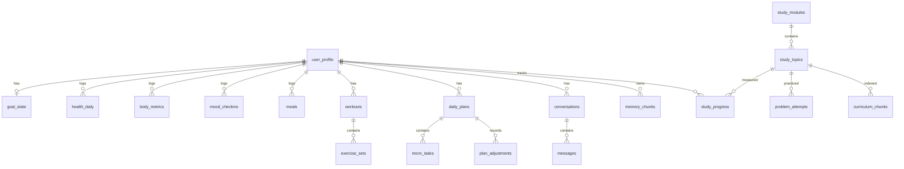
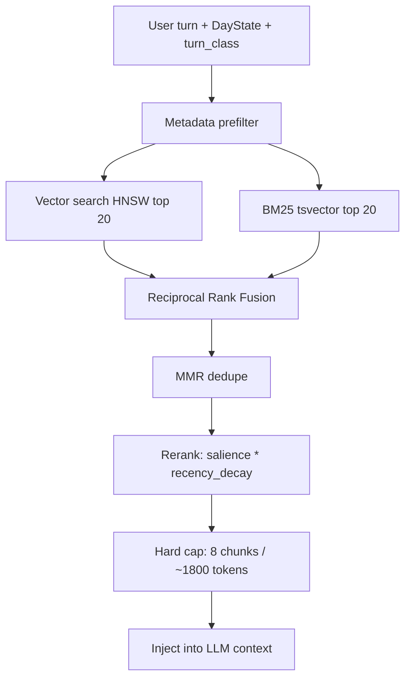

# Data Model & Long-Term Memory Design

Relational metadata and vector memory share one Supabase Postgres database. All user-owned tables are scoped by `user_id` with row-level security so solo use today becomes multi-tenant tomorrow without a schema rewrite.

Executable DDL: [../supabase/migrations/0001_init.sql](../supabase/migrations/0001_init.sql).

---

## 1. Entity overview



---

## 2. Relational schema

### 2.1 Profile & goals

**`user_profile`**
| Column | Type | Notes |
|---|---|---|
| `id` | `uuid` PK | Equals `auth.users.id` |
| `display_name` | `text` | |
| `sex` | `text` | |
| `height_cm` | `numeric` | ~168–170 for this user |
| `birth_year` | `int` | |
| `timezone` | `text` | e.g. `Asia/Kolkata` |
| `hard_dislikes` | `text[]` | Foods / textures permanently banned |
| `appetite_notes` | `text` | e.g. low morning appetite |
| `created_at` / `updated_at` | `timestamptz` | |

**`goal_state`**
| Column | Type | Notes |
|---|---|---|
| `user_id` | `uuid` PK/FK | |
| `goal_type` | `text` | `lean_bulk` \| `recomp` \| `cut` \| `maintain` |
| `target_weight_kg` | `numeric` | Soft target; never daily-policed |
| `protein_floor_g_per_kg` | `numeric` | Default `1.6`; RED days use `1.4` |
| `surplus_kcal` | `int` | Soft; **not surfaced on AMBER/RED** |
| `training_split` | `text` | e.g. `full_body_3x` |
| `study_minutes_green` | `int` | Default 60–90 |
| `active_from` | `date` | |
| `notes` | `text` | |

### 2.2 Biometrics & body

**`health_daily`** — one row per local calendar day
| Column | Type | Notes |
|---|---|---|
| `user_id`, `day` | PK | `day` is `date` in user timezone |
| `sleep_start`, `sleep_end` | `timestamptz` | |
| `sleep_hours` | `numeric` | |
| `sleep_efficiency` | `numeric` | 0–1 |
| `sleep_stages` | `jsonb` | `{awake, rem, core, deep}` minutes |
| `hrv_sdnn_ms` | `numeric` | |
| `rhr_bpm` | `numeric` | |
| `active_energy_kcal` | `numeric` | |
| `steps` | `int` | |
| `wake_detected_at` | `timestamptz` | Drives check-in offsets |
| `hrv_baseline_14d` | `numeric` | Rolling baseline snapshot |
| `rhr_baseline_14d` | `numeric` | |
| `readiness_score` | `numeric` | 0–1, written by engine |
| `day_state` | `text` | `GREEN` \| `AMBER` \| `RED` \| `DELOAD` |
| `source` | `text` | `healthkit` |

**`body_metrics`**
| Column | Type | Notes |
|---|---|---|
| `id` | `uuid` PK | |
| `user_id` | `uuid` | |
| `measured_at` | `timestamptz` | |
| `weight_kg` | `numeric` | Raw weigh-in |
| `weight_ewma` | `numeric` | Exponentially weighted; **dashboard uses this** |
| `waist_cm` | `numeric` | Optional |
| `photo_path` | `text` | Optional private storage path |
| `notes` | `text` | |

### 2.3 Mood, meals, training

**`mood_checkins`**
| Column | Type | Notes |
|---|---|---|
| `id` | `uuid` PK | |
| `user_id` | `uuid` | |
| `logged_at` | `timestamptz` | |
| `valence` | `smallint` | 1–5 |
| `energy` | `smallint` | 1–5 |
| `stress` | `smallint` | 1–5 |
| `trigger_text` | `text` | Free text; feeds memory |
| `source` | `text` | `voice` \| `tap` \| `watch` |

**`meals`**
| Column | Type | Notes |
|---|---|---|
| `id` | `uuid` PK | |
| `user_id` | `uuid` | |
| `logged_at` | `timestamptz` | |
| `food_name` | `text` | Loose, natural language |
| `protein_g_est` | `numeric` | Estimate, not lab precision |
| `calories_est` | `numeric` | Nullable; often hidden from UI |
| `satiety` | `smallint` | 1–5 |
| `was_convenience_food` | `boolean` | |
| `effort` | `text` | `none` \| `low` \| `cook` |
| `texture` | `text` | e.g. `drinkable`, `soft` — for low-appetite retrieval |
| `liked` | `boolean` | Nullable until confirmed |

**`workouts` / `exercise_sets`**
- `workouts`: `prescribed_minutes`, `actual_minutes`, `rpe`, `volume_multiplier`, `day_state`, `completed`
- `exercise_sets`: `exercise_name`, `prescribed_reps`, `actual_reps`, `load_kg`, `rpe`

### 2.4 Study programme roadmap

**`study_modules`** — shared catalog (no `user_id`)
- `id`, `ordinal`, `title`, `description`

**`study_topics`**
- `id`, `module_id`, `ordinal`, `title`, `difficulty`, `concept_summary`

**`study_progress`** — per user
- `user_id`, `topic_id`, `mastery` (0–1), `last_practiced_at`, `status` (`not_started` \| `learning` \| `review` \| `mastered`)

**`problem_attempts`**
- `user_id`, `topic_id`, `problem_ref` (LeetCode-style slug), `difficulty`, `outcome` (`solved` \| `partial` \| `stuck` \| `skipped`), `bug_tags text[]`, `minutes_spent`, `hints_used`, `attempted_at`

`bug_tags` examples: `off_by_one`, `recursion_base_case`, `wrong_ds`, `edge_empty_input`, `time_limit`. These promote into `memory_chunks.kind = 'bug_pattern'`.

### 2.5 Plans & conversations

**`daily_plans`**
- `user_id`, `day`, `day_state`, `wake_at`, `tone`, `nutrition jsonb`, `workout jsonb`, `study jsonb`, `suppress_checkins_until`, `created_at`

**`micro_tasks`**
- `plan_id`, `kind` (`intake` \| `movement` \| `study` \| `recovery` \| `social`), `title`, `minutes`, `counts_toward_streak`, `completed_at`, `sort_order`

**`plan_adjustments`**
- `plan_id`, `from_state`, `to_state`, `reason`, `diff jsonb`, `created_at` — audit trail for why volume/calories/study were dialed back

**`conversations` / `messages`**
- Raw transcript retained **30 days**, then summarized into memory and deleted (or soft-deleted).
- `messages`: `role` (`user` \| `assistant` \| `system`), `content`, `turn_class`, `model_tier`, `token_counts jsonb`

---

## 3. Vector schema

### 3.1 `memory_chunks` (per-user, mutable)

| Column | Type | Notes |
|---|---|---|
| `id` | `uuid` PK | |
| `user_id` | `uuid` | RLS |
| `kind` | `text` | `episodic` \| `semantic` \| `preference` \| `trigger` \| `bug_pattern` |
| `source_id` | `uuid` | Nullable FK-ish to message / meal / mood |
| `content` | `text` | Chunk text embedded as-is |
| `embedding` | `vector(768)` | Gemini `text-embedding-004` |
| `metadata` | `jsonb` | Free-form filters (food texture, topic_id, etc.) |
| `salience` | `real` | 0–1; boosted on re-access / explicit confirm |
| `content_tsv` | `tsvector` | Generated from `content` for BM25 |
| `last_accessed_at` | `timestamptz` | |
| `created_at` | `timestamptz` | |
| `expires_at` | `timestamptz` | Episodic only; cleared on promotion |

Indexes:
- HNSW on `embedding` (`vector_cosine_ops`)
- GIN on `content_tsv`
- B-tree on `(user_id, kind, created_at desc)`

### 3.2 `curriculum_chunks` (shared, immutable)

| Column | Type | Notes |
|---|---|---|
| `id` | `uuid` PK | |
| `module_id` / `topic_id` | `uuid` | |
| `parent_doc_id` | `uuid` | Self-FK for parent-document retrieval |
| `content` | `text` | |
| `embedding` | `vector(768)` | |
| `metadata` | `jsonb` | `{section_title, token_count, difficulty}` |
| `content_tsv` | `tsvector` | |

No `user_id` — one corpus for all users. Personalization happens via `study_progress` filters at query time.

---

## 4. Chunking strategies

| Source | Strategy | Why |
|---|---|---|
| Course lectures / notes | Semantic section splits at **350–500 tokens**; store child chunks with `parent_doc_id` pointing at the full section | Hit on a sub-chunk returns the full parent for tutor context |
| Conversation logs | **Turn-pair** chunks (user + assistant); never mid-utterance | Preserves dialog coherence for preference/trigger mining |
| Mood / meal confirmations | Single short semantic fact | e.g. "Dislikes mass-gainer shakes — bloating" → `kind=preference` |
| Problem attempts | One chunk per recurring `bug_tag` cluster | e.g. "Recurring recursion base-case misses on trees" → `kind=bug_pattern` |

### Nightly consolidation

```
for each user:
  episodic = memory_chunks where kind='episodic' and created_at < now() - interval '24 hours'
  ask Flash-tier to extract durable facts → semantic | preference | trigger | bug_pattern
  insert promoted rows with higher salience
  delete (or expire) source episodic rows
  delete messages older than 30 days after summarization
```

This caps unbounded growth and is what prevents context loss across months without stuffing the entire history into every prompt.

---

## 5. Memory retrieval pipeline



### Steps in detail

1. **Prefilter** — `user_id = auth`, optional `kind IN (...)`, optional `created_at` window, optional `metadata @>` (e.g. `{texture: drinkable}` for low-appetite meal retrieval).
2. **Parallel retrieval** — cosine HNSW and `ts_rank_cd` BM25, each top 20.
3. **RRF** — `score = Σ 1 / (k + rank_i)` with `k=60`.
4. **MMR** — drop near-duplicate chunks (cosine > 0.92) to keep diversity.
5. **Rerank** — `final = rrf * (0.5 + 0.5 * salience) * recency_decay(last_accessed_at)`.
6. **Cap** — max 8 chunks, ~1800 tokens total, so Flash-tier TTFT stays inside the voice budget.
7. **Touch** — bump `last_accessed_at` and slightly raise `salience` on returned rows.

### Example: low-appetite morning retrieval

```sql
-- Conceptual; see retrieve.py for the full hybrid query
WHERE user_id = $1
  AND kind IN ('preference', 'semantic')
  AND metadata @> '{"appetite":"low"}'::jsonb
  AND COALESCE(metadata->>'disliked','false') <> 'true'
ORDER BY embedding <=> $query_vec
LIMIT 20;
```

---

## 6. Baseline user seed (this profile)

On first launch, seed `user_profile` + `goal_state`:

```json
{
  "height_cm": 175,
  "goal_type": "lean_bulk",
  "protein_floor_g_per_kg": 1.6,
  "surplus_kcal": 200,
  "training_split": "full_body_3x",
  "study_minutes_green": 60,
  "appetite_notes": "Low appetite on waking; avoid rigid breakfast pressure",
  "hard_dislikes": ["mass-gainer shakes"]
}
```

Weight (~70 kg) is written via the first `body_metrics` weigh-in, not hard-coded into the profile forever.

---

## 7. Retention & privacy

| Data | Retention |
|---|---|
| `health_daily`, `body_metrics` | Indefinite (user-owned) |
| `messages` raw | 30 days → summarize → delete |
| `memory_chunks` episodic | ≤48h unless promoted |
| `memory_chunks` semantic/preference/trigger/bug_pattern | Indefinite; user can delete |
| Neural TTS audio | Not stored; streamed ephemeral |
| On-device audio for STT | Never uploaded by default |
