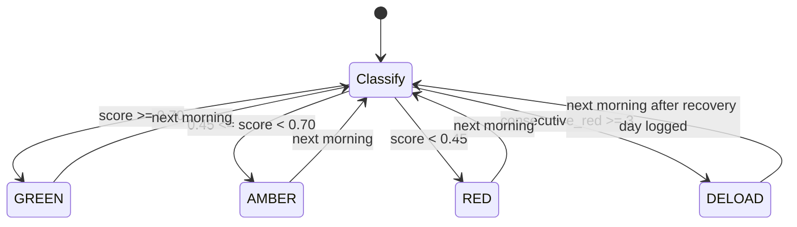

# Behavioral & Dynamic Logic Engine

The readiness engine converts sleep, HRV, RHR, and subjective mood into a `DayState`, then adapts training volume, nutrition framing, and study load. Empathy and burnout-avoidance are **system invariants**, not prompt suggestions.

Implementation target: `backend/app/engine/readiness.py` and `adapter.py`.

---

## 1. Day states

| State | Meaning | User experience |
|---|---|---|
| `GREEN` | Recovered enough for full stimulus | Normal volume, protein + soft surplus, 60–90 min study |
| `AMBER` | Mediocre recovery | 70% volume, protein floor only (no calorie number), 30 min study |
| `RED` | Poor sleep / high stress / low energy | Movement snack, protein floor, 15 min easy study, empathetic tone |
| `DELOAD` | Forced after ≥3 consecutive RED days | Same as RED plus explicit recovery framing; no progression asks |



---

## 2. Readiness scoring

Inputs for local calendar day `D`:

- `health_daily` for `D` (or previous night's sleep ending on `D`)
- Latest `mood_checkins` since wake (optional; absence ≠ failure)
- 14-day baselines already snapshotted on `health_daily`

```python
from dataclasses import dataclass
from enum import Enum
from datetime import timedelta

class DayState(str, Enum):
    GREEN = "GREEN"
    AMBER = "AMBER"
    RED = "RED"
    DELOAD = "DELOAD"

class Tone(str, Enum):
    COACHING = "coaching"
    NEUTRAL = "neutral"
    EMPATHETIC_NO_GUILT = "empathetic_no_guilt"

def clamp(x: float, lo: float, hi: float) -> float:
    return max(lo, min(hi, x))

def z_to_unit(value: float, baseline: float, sigma: float = None) -> float:
    """Higher-is-better metric (HRV) → 0..1 around personal baseline."""
    if baseline is None or value is None:
        return 0.5
    sigma = sigma or max(baseline * 0.15, 1.0)
    z = (value - baseline) / sigma
    return clamp(0.5 + z * 0.25, 0.0, 1.0)

def inv_z_to_unit(value: float, baseline: float, sigma: float = None) -> float:
    """Lower-is-better metric (RHR) → 0..1."""
    if baseline is None or value is None:
        return 0.5
    sigma = sigma or max(baseline * 0.08, 1.0)
    z = (baseline - value) / sigma
    return clamp(0.5 + z * 0.25, 0.0, 1.0)

def classify_day(health, mood, history) -> tuple[float, DayState]:
    s = 0.0
    s += clamp(health.sleep_hours / 7.5, 0, 1) * 0.30
    s += clamp((health.sleep_efficiency or 0.85) / 0.90, 0, 1) * 0.15
    s += z_to_unit(health.hrv_sdnn_ms, history.hrv_baseline) * 0.25
    s += inv_z_to_unit(health.rhr_bpm, history.rhr_baseline) * 0.15

    if mood is not None:
        s += (mood.energy / 5.0) * 0.15
        # Subjective veto: stress/low mood can cap a good biometric day.
        # Biometrics never override a bad subjective report upward.
        if mood.stress >= 4 or mood.valence <= 2:
            s = min(s, 0.45)
    else:
        s += 0.5 * 0.15  # neutral energy prior

    if history.consecutive_red >= 3:
        return s, DayState.DELOAD

    if s >= 0.70:
        return s, DayState.GREEN
    if s >= 0.45:
        return s, DayState.AMBER
    return s, DayState.RED
```

Scores and `day_state` are written back to `health_daily` and stamped onto `daily_plans`.

---

## 3. Plan adaptation

```python
@dataclass
class NutritionPlan:
    surface_calories: bool
    protein_floor_g: float
    first_intake: dict | None
    meal_count: int

@dataclass
class StudyBlock:
    minutes: int
    task: dict | None
    allow_hints: bool
    counts_toward_streak: bool

@dataclass
class DailyPlan:
    day_state: DayState
    tone: Tone
    volume_multiplier: float
    workout: dict
    nutrition: NutritionPlan
    study: StudyBlock
    suppress_checkins_until: object | None
    micro_tasks: list

def baseline_plan(ctx) -> DailyPlan:
    protein = ctx.profile.weight_kg * ctx.goals.protein_floor_g_per_kg
    return DailyPlan(
        day_state=DayState.GREEN,
        tone=Tone.COACHING,
        volume_multiplier=1.0,
        workout=prescribe_full_session(ctx),
        nutrition=NutritionPlan(
            surface_calories=True,
            protein_floor_g=protein,
            first_intake=None,
            meal_count=3,
        ),
        study=StudyBlock(
            minutes=ctx.goals.study_minutes_green,
            task=next_study_topic(ctx),
            allow_hints=True,
            counts_toward_streak=True,
        ),
        suppress_checkins_until=None,
        micro_tasks=[],
    )

def adapt_plan(state: DayState, ctx) -> DailyPlan:
    plan = baseline_plan(ctx)
    plan.day_state = state

    if state in (DayState.RED, DayState.DELOAD):
        # Training: keep the habit cue, drop the stimulus.
        plan.workout = pick_movement_snack(ctx)  # 10–15 min, RPE <= 5
        plan.volume_multiplier = 0.4

        # Nutrition: protein floor only. Never show a calorie target today.
        # Late wake + no appetite → skip "breakfast" framing entirely.
        plan.nutrition = NutritionPlan(
            surface_calories=False,
            protein_floor_g=ctx.profile.weight_kg * 1.4,
            first_intake=retrieve_liked_option(
                ctx,
                filters={
                    "appetite": "low",
                    "effort": "none",
                    "disliked": False,
                    "texture": "drinkable",
                },
            ),
            meal_count=2,
        )

        plan.study = StudyBlock(
            minutes=15,
            task=easiest_unfinished_topic(ctx, below_mastery=True),
            allow_hints=True,
            counts_toward_streak=True,
        )
        plan.tone = Tone.EMPATHETIC_NO_GUILT
        plan.suppress_checkins_until = ctx.wake_time + timedelta(minutes=45)

    elif state == DayState.AMBER:
        plan.volume_multiplier = 0.7
        plan.workout = scale_session(plan.workout, 0.7)
        plan.study.minutes = 30
        plan.nutrition.surface_calories = False
        plan.tone = Tone.NEUTRAL

    else:  # GREEN
        plan.tone = Tone.COACHING

    plan.micro_tasks = build_micro_tasks(plan, ctx)
    log_adjustment(ctx.user_id, state, plan, reason=explain(state, ctx))
    return plan
```

### Micro-task construction rules

Every adapted plan produces **at least one** streak-eligible micro-task:

| State | Required anchors |
|---|---|
| GREEN | Intake ×3 soft prompts, full workout, study block |
| AMBER | Intake ×2–3 (no kcal), scaled workout, 30m study |
| RED / DELOAD | One low-effort intake, one movement snack, one 15m study **or** recovery walk — user picks; completing any one = showed up |

---

## 4. Worked example: wake 11:00, poor sleep

**Facts:** Sleep 4.8h, efficiency 0.72, HRV well below 14d baseline, RHR elevated, mood energy=2 stress=4, wake_at=11:00.

1. `classify_day` → score ≈ 0.32 → `RED` (subjective veto would have capped at 0.45 even if biometrics were better).
2. `adapt_plan(RED)`:
   - Workout → 12-minute walk + 2× band pull-aparts, RPE ≤ 5.
   - Nutrition → protein floor ≈ `70 * 1.4 ≈ 98g`; first intake retrieved from preferences with `texture=drinkable`, `effort=none` (e.g. flavored milk + banana / protein coffee — **not** a mass-gainer). Calories **not** shown.
   - Study → 15 minutes on easiest unfinished topic below mastery; hints allowed.
   - Tone → `empathetic_no_guilt`.
   - Check-ins suppressed until 11:45.
3. Voice opener (system constraint, not freeform):

> Rough night — we are not doing a full day. One easy sip-something when you are ready, a short walk later, and fifteen minutes on an easy problem if the head clears. Nothing else is owed.

4. Completing the 15-minute study block increments `daily_streaks.showed_up = true` the same as a GREEN day.

---

## 5. Anti-burnout invariants (hard rules)

These are enforced in code paths that build plans and score streaks. Prompts may reinforce them but cannot override them.

### I1 — Minimum viable day

- Every `DayState`, including `DELOAD`, yields ≥1 achievable streak-eligible task.
- The app never presents a zero-task day and never presents a task the engine itself classified as unreachable given current state.

### I2 — Streaks measure showing up, not hitting targets

- `daily_streaks.showed_up` flips true when **any** streak-eligible micro-task is completed.
- A 15-minute RED study block increments the same counter as a full GREEN day.
- Missed calorie / volume / problem quotas do **not** break the streak.
- This directly targets the 3-day abandonment loop caused by rigid perfectionism.

### I3 — No catch-up debt

- Missed volume, calories, and problems are never rolled into tomorrow.
- The planner recomputes from **today's** readiness only.
- Weekly frontier review may *suggest* a gentle rebalance, but it cannot inflate a single day's targets above the state's caps.

---

## 6. Voice tone mapping

| `plan.tone` | First-turn constraints |
|---|---|
| `coaching` | Clear plan readout OK; one primary ask; light accountability |
| `neutral` | Short plan; no pep-talk; offer choices |
| `empathetic_no_guilt` | Acknowledge state first; **one** small ask; forbid "you should have" / deficit language / stacked obligations |

The gateway injects `plan.tone` into the system prompt on every turn that day. Model output that violates `empathetic_no_guilt` rules is regenerated once on Flash-tier before TTS.

---

## 7. Nutrition philosophy (example persona)

Tuned for an example persona: low morning appetite, limited time to cook, relies on convenience foods, has bounced off mass-gainer shakes before.

| Rule | Behavior |
|---|---|
| Protein floor > calorie target | Especially on AMBER/RED — hide kcal entirely |
| No breakfast dogma | Late wake → first intake is "when ready", not a meal slot |
| Preference memory wins | Retrieve liked, low-effort, non-disliked options before inventing meals |
| Convenience is valid | `was_convenience_food=true` is logged without shame; still counts toward protein |
| Never prescribe mass-gainers if in `hard_dislikes` | Hard filter in retrieval |

---

## 8. Study adaptation

| State | Minutes | Difficulty bias | Tutor mode |
|---|---|---|---|
| GREEN | 60–90 | At or slightly above mastery | Socratic hints |
| AMBER | 30 | At mastery | Hints early |
| RED / DELOAD | 15 | **Below** mastery | Hints + smaller problem; still counts for streak |

DSA tutor hard guardrail (Phase 3): never emit a full working solution for the assigned problem. Max: conceptual nudge → complexity hint → partial pseudocode skeleton → test-case idea. Raw solutions are a policy reject, not a prompt wish.
